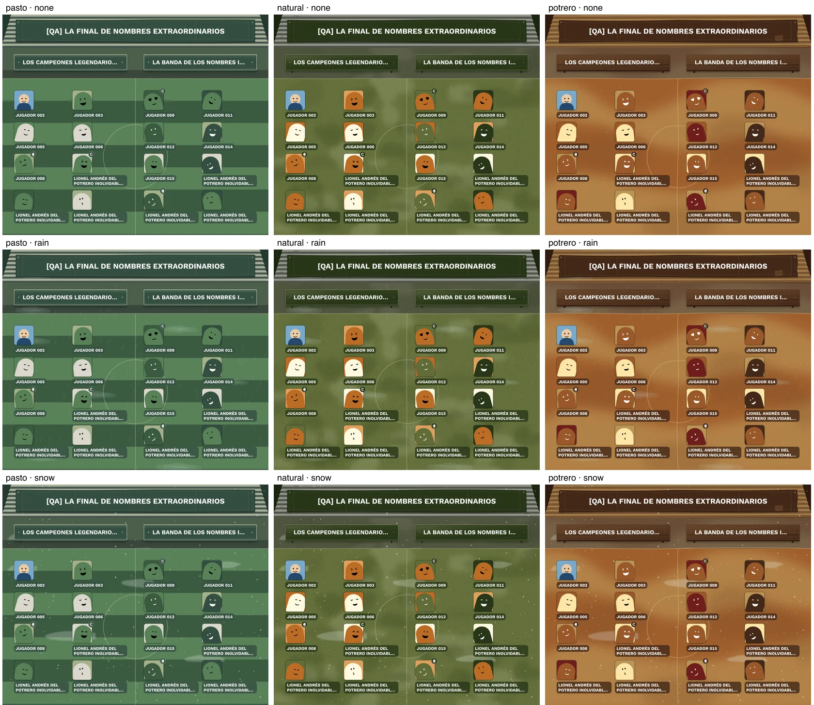

# Local export verification

Run with Node 24, `npm ci`, the local PostgreSQL/Clerk Development environment described in README, and `npm run dev` on port 3000.

```sh
npm run fixtures:export -- --user-id=<local-clerk-user-id> --write
npm run test:export
npm run test:integrity:local -- --user-id=<local-clerk-user-id>
npm run test:export:local -- --user-id=<local-clerk-user-id>
```

The fixture script defaults to a dry run without `--write`. Both scripts reject non-local databases and require both Clerk keys to be test keys. Seeding is idempotent by account and fixture name and never replaces existing matches. To create the same cases in another local account, explicitly pass that account's user ID. The browser runner verifies ownership, signs into that test account with a short-lived ticket, and restores the original fixture team data and any temporary names after its temporary UI edits. It does not change Production.

## Fixtures

| Case | Players per team | Purpose |
| --- | --- | --- |
| One each | 1 / 1 | Minimum field, shared roles, empty grid slots |
| Long names + uploaded-image sample | 8 / 8 | Ellipsis, wrapping, palette-independent image |
| Match maximum | 20 / 20 | Maximum allowed PNG and roster scrolling |
| Uneven maximum | 1 / 20 | Highly asymmetric valid rosters |
| Near match limit | 19 / 19 | Bulk entry accepts two remaining places, rejects three |
| Oversized team | 21 / 1 | Team-capacity validation and blocked download |
| Oversized match | 21 / 20 | Legacy match above 40 players and blocked download |
| Roles | 3 / 3 | Captain/goalkeeper persistence and roster changes |
| Legacy three-team match | 2 / 2 / 2 | Disabled export, tooltip, HTTP 422 and repair |
| Empty team | 2 / 0 | Incomplete-team state |
| Unassigned player | 1 / 1 + 1 waiting | Assignment validation |

Limits are imported from `utils/player-limits.ts`: 20 per team, 40 per match. Both fixtures and product code use these constants; the old player-limit environment variables are no longer used. Existing fixtures are preserved, so older 100-player examples can remain as invalid legacy data. Selected role suggestions and match IDs are written to ignored `.local/export-fixtures.json`. Captains are deliberately not auto-selected in product behavior.

## Coverage

- 54 real PNG requests: 3 surfaces × 3 weather options × 3 image presentations × 2 alignments. Validate PNG content type, nonempty decoded image, width 2560 and bounded dynamic height.
- Eight additional real PNGs: minimum, maximum, asymmetric and role fixtures, with and without images.
- Every successful PNG is fully decoded into raw pixels before recording its result; reading header metadata alone cannot detect a truncated image.
- Actual editor interactions: remembered appearance, match-scoped roles, changing team membership, role invalidation even through closed-editor round trips, large role menus with keyboard selection, and repair of legacy data.
- Capacity checks: bulk-entry remaining-place feedback and errors at 320 px, 38 + 2 accepted, 38 + 3 blocked, direct server additions and oversized batches rejected without writes, full-team assignment disabled, valid 20-versus-20 composition, and direct 21-versus-19 save rejected. The add-player modal scrolls within the viewport when its form or errors exceed the available height.
- Fault injection confined to the disposable test page: save failure, image failure after save, retry without repeat save, independent save, repeated downloads and processing/success controls.
- Page and modal checks at 320, 390, 639, 640, 767, 768, 1023, 1024, 1279, 1280 and 1440 CSS pixels. No document, dialog or control-panel horizontal overflow; preview appears from 1024 px.
- Unit coverage for request validation, all option combinations, global preference replacement, unavailable browser storage, role deletion/swaps, explicit unassigned roles and per-match isolation.

Artifacts are written to ignored `.local/export-qa/`: retained PNGs, screenshots, logs and `report.json`. `--skip-matrix` reruns UI/state/responsive checks without repeating the 62 PNG requests. Reports should be read together when using that option.

## Fast integrity checks

`test:integrity:local` exercises the actual PostgreSQL player-write queries, without launching a browser or generating images. It requires a loopback database and an explicit local fixture account. Temporary matches are deleted after the run. Seven cases cover concurrent individual/bulk/mixed additions, concurrent duplicate names, duplicates within a batch, ownership and oversized batches.

Each player-add transaction locks its match row, verifies ownership, then checks capacity/names and inserts on the same connection. [PostgreSQL row locks](https://www.postgresql.org/docs/current/explicit-locking.html#LOCKING-ROWS) serialize additions to that match until commit or rollback. Different matches use different row locks.

Match creation and edits parse the same strict name schema as the form; updates only accept name and teams. Automatically generated copy names reserve space for their prefix and timestamp within 40 characters.

## Visual review



The three palettes remain distinct and coherent across stand, signs, ground and generated faces. White labels remain readable; uploaded imagery stays unchanged. No color changes are required for this PR.

Two optional follow-ups for owner review, not applied here:

- Reduce accumulated snow opacity slightly if its soft white patches feel like fog rather than snow.
- Consider spanning a single player across both team columns, or centering the smaller team's roster independently in extremely uneven matches. Current behavior preserves the approved fixed grid and joint vertical alignment.

## Verified run

Local verification on 2026-10-21 completed 62 decoded PNG exports, 57 browser behavior checks, 21 unit tests and the 11 viewport checks above. With the 20-player team limit, PNGs were 2560 pixels wide and ranged from 1470 to 3848 pixels high. The initial pass found page overflow at 320 and 768 pixels in existing roster/team rows; the final pass with 40-character unbroken player/match names had no page, modal or options-panel overflow.

That full run predates the latest single-line player-name and field-line junction changes. Per the owner's request, image/browser matrices and builds remain paused until the PR's final verification stage. The latest fast pass covers 24 unit tests, the seven PostgreSQL integrity cases, TypeScript and lint; no new PNG or visual verification is claimed for those changes.
